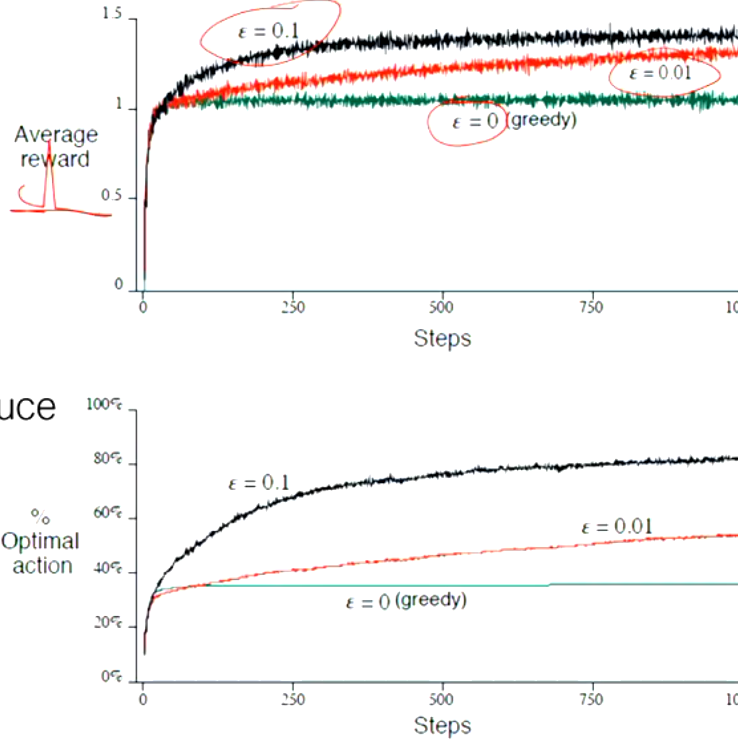
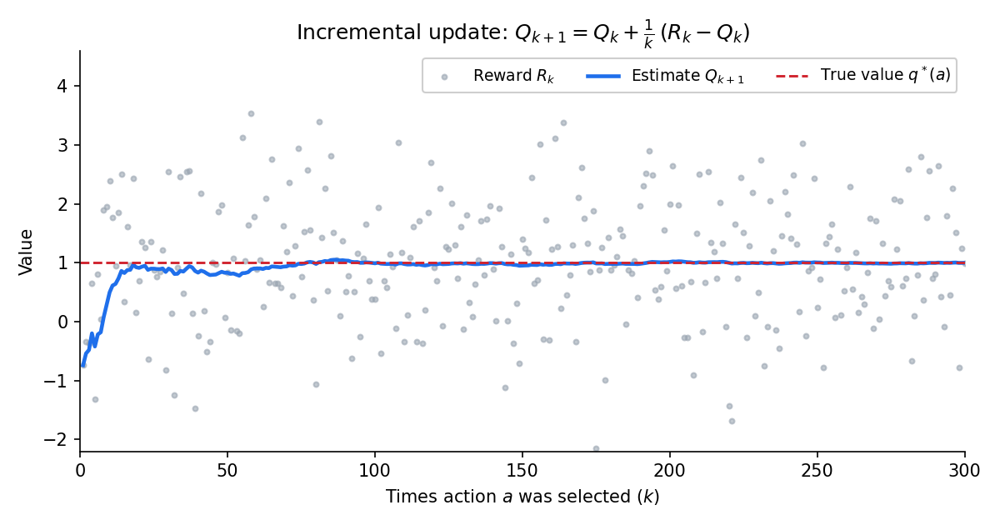
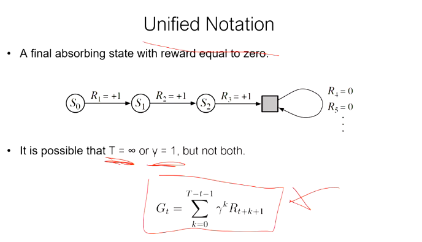

# 4. Reinforcement Learning

Reinforcement Learning (RL) is a type of machine learning where an agent learns by **interacting with its environment**. Unlike supervised learning, where the agent learns from labeled data, RL involves learning from the consequences of its actions, without explicit instructions. The agent must figure out the best actions to take through trial and error, guided by a system of **rewards** and **punishments**.

#### Key Characteristics:
- **No explicit instructor**: The agent is not directly told what to do but instead learns by observing the results of its actions.
- **Direct sensorimotor connection**: The agent directly interacts with the environment, taking actions and observing outcomes through sensors.

#### Agent’s Learning Process:
1. The agent is in a **state** \( s \).
2. The agent takes an **action** \( a \).
3. The agent observes the next **state** of the environment \( s' \).
4. The agent receives a **reward** \( r' \), which can be positive (as a reward) or negative (as a punishment).

This loop continues as the agent interacts with the environment to maximize the cumulative reward over time.

#### Agent-Environment Interaction:
- **Agent** takes action \( A_t \), which affects the environment.
- The **Environment** responds by providing the next state \( S_{t+1} \) and a reward \( R_{t+1} \) to the agent.

\[
\text{Agent} \overset{A_t}{\longrightarrow} \text{Environment} \quad \overset{S_{t+1}}{\longrightarrow} \overset{R_{t+1}}{\longrightarrow} \text{Agent}
\]

An example of reinforcement learning in action is the **Pole Balancing** task, which is similar to controlling a rocket's landing, such as what SpaceX does with its reusable rockets. The agent (a controller) learns to balance a pole (or land a rocket) by making adjustments based on the current state (e.g., position and angle) to maximize the reward (successful balance or landing).

#### Different Types of Learning:
- **Supervised Learning**: The agent learns from labeled data provided by an instructor. It has explicit inputs and corresponding outputs to learn from.
- **Unsupervised Learning**: The agent learns from patterns in the data without any labels or direct guidance.
- **Reinforcement Learning**: The agent learns through trial and error by interacting with the environment, receiving feedback in the form of rewards or punishments.

---

### 4.1 Elements of Reinforcement Learning
Reinforcement learning is built upon several core elements that define how the agent interacts with and learns from the environment:

#### 1. **Policy**:
>  "Given this state, take this action"
> (e.g. Be smartly greedy with a bit of exploration)
- A **policy** defines the agent’s behavior at any given time. It is a mapping from states to actions, telling the agent which action to take in each state. The policy can be deterministic (always taking the same action in a given state) or stochastic (taking actions with certain probabilities).
- Example: In a game, the policy might dictate whether the agent moves left or right based on its current position.

#### 2. **Reward Function**:
> "Instant Gratification; Black Wolf"
- The **reward function** defines the goal of the agent by assigning a scalar reward to each action or state. It tells the agent how good or bad an action is based on the immediate outcome.
- The goal of the agent is to maximize the cumulative reward over time.
- Example: In a video game, the agent receives a reward for collecting coins or reaching checkpoints.

#### 3. **Value Function**:
> "Long-term Discipline, White Wolf"
- A **value function** estimates how good a particular state (or state-action pair) is in the long run. It reflects the total expected reward that can be obtained from that state onward.
- While the reward function gives immediate feedback, the value function provides a broader view of the long-term consequences of actions.
- Example: In chess, the value of a certain board position might reflect the agent’s likelihood of winning from that position, rather than the immediate score.

#### 4. **(Optional) Model of the Environment**:
- A **model** allows the agent to predict the next state and the reward it will receive after taking a certain action. If the agent has a model, it can plan ahead by simulating actions and their outcomes without interacting with the actual environment.
- Model-based RL uses this to improve learning efficiency, while model-free RL learns purely through direct interaction with the environment.


RL typically follows the below process to maximize cumulative rewards over time through **trial and error**:


1. **Agent-Environment Interaction**:
    - The agent is placed in an environment where it takes actions and receives feedback in the form of rewards. 
    - At each time step \( t \), the agent is in a state \( S_t \), selects an action \( A_t \), and receives a reward \( R_{t+1} \), transitioning to the next state \( S_{t+1} \).
    
    \[
    \text{Agent} \overset{A_t}{\longrightarrow} \text{Environment} \quad \overset{S_{t+1}}{\longrightarrow} \overset{R_{t+1}}{\longrightarrow} \text{Agent}
    \]

2. **Policy and Action Selection**:
    - **Policy**: The agent's behavior is determined by a policy \( \pi(s) \), which maps states to actions. 
    - **Action Selection Strategies**:
      - **Greedy**: Selects the action with the highest estimated value.
      - **Epsilon-Greedy**: With probability \( \epsilon \), selects a random action (exploration); with probability \( 1 - \epsilon \), selects the greedy action (exploitation).
      - **Softmax**: Selects actions probabilistically based on their estimated values, allowing both exploration and exploitation.
      
      Example of the **epsilon-greedy strategy**:
      - With probability \( 1 - \epsilon \):
         \[
         A_t^* = \arg \max_a Q_t(a)
         \]
        i.e. The agent chooses the action that gives the **highest expected return**.
      - With probability \( \epsilon \), select a random action. 

      - At any time step \( t \), the agent wants to take the action that maximizes its long-term rewards based on its current estimates of action-values \( Q_t(a) \). 
      The agent evaluates all available actions \( a \) and selects the one that has the highest value of \( Q_t(a) \). In other words:
      - **\( A^*_t \)** is the action that **maximizes** the agent’s **expected future rewards** according to its current knowledge.
      - **\( Q_t(a) \)** is the [Action-value Estimation](#RL-action-value-estimation)

      e.g.
      Suppose at time \( t \), the agent has the following estimates for \( Q_t(a) \) for three possible actions in a given state:
      - \( Q_t(a_1) = 5 \)
      - \( Q_t(a_2) = 8 \)
      - \( Q_t(a_3) = 3 \)

      Using \( A^*_t = \arg \max_a Q_t(a) \), the agent will select action \( a_2 \), since it maximizes \( Q_t(a_2) = 8 \). Therefore:
      \[
      A^*_t = a_2
      \]
      This means the agent will take action \( a_2 \) at time \( t \) because it expects to receive the highest long-term reward.


3. **Experience Generation**:
    - The agent generates experiences by interacting with the environment and observing **state-action-reward transitions**. An episode ends when the agent reaches a terminal state, or after a predefined number of time steps.

    \[
    (S_0, A_0, R_1), (S_1, A_1, R_2), \dots, (S_T, A_T, R_{T+1})
    \]
    
4. **Learning (Value Function Estimation)**:
    - (If using Monte Carlo methods) After each episode, the agent updates its **value function** based on the total rewards (returns) obtained.
    - i.e. learning happens **after the episode finishes**, using the total return \( G_t \) from a particular state or state-action pair.
    
     e.g. [Monte Carlo Methods](#RL-monte-carlo):
    \[
    V(S_t) \leftarrow V(S_t) + \alpha \left( G_t - V(S_t) \right)
    \]
    - Where \( G_t \) is the sum of future rewards from time step \( t \) to the end of the episode:
      \[
      G_t = R_{t+1} + R_{t+2} + \dots + R_T
      \]
      
    For action-value estimation:
    \[
    Q(S_t, A_t) \leftarrow Q(S_t, A_t) + \alpha \left( G_t - Q(S_t, A_t) \right)
    \]
    
    If using [Temporal Difference](#RL-temporal-difference) method, learning happens during the episode. 

5. **Return Calculation**:
    - The **return** \( G_t \) is the cumulative sum of rewards obtained after taking an action in state \( S_t \). This is the feedback that the agent uses to improve its estimates of future rewards.

6. **Updating the Policy**:
    - After the value function has been updated based on the return, the agent can improve its **policy** (action-selection strategy) based on the newly learned values. This step helps the agent refine its action choices, making it more likely to select actions that maximize long-term rewards in the future.

---

### 4.2 Exploration vs Exploitation
A fundamental challenge in reinforcement learning is the trade-off between **exploration** and **exploitation**:

#### **Exploitation**:
- **Exploitation** refers to choosing the action that the agent currently believes will yield the highest reward. This is based on its past experience and learned value functions.
- The downside is that exploitation can lead the agent to get **stuck in a local optimum** because it always chooses the best-known option without exploring potentially better alternatives.

#### **Exploration**:
- **Exploration** refers to choosing actions that the agent is less certain about, in order to discover new information. By trying different actions, the agent may find a better strategy or higher reward that it didn’t know about before.
- The downside is that exploration may result in short-term suboptimal rewards as the agent tries less favorable actions.

#### Balancing Exploration and Exploitation:
- A good RL agent balances **exploration** and **exploitation** to maximize long-term reward. Too much exploitation may prevent the agent from finding better strategies, while too much exploration may prevent it from taking advantage of known good actions.
- A common technique to balance this is the **epsilon-greedy** strategy, where the agent usually exploits the best-known action but occasionally explores a random action.


### Action-value Estimation {#RL-action-value-estimation}

- **\( q^*(a) \)**: The **true action value**, which represents the expected return from taking action \( a \) and following the optimal policy thereafter. It is fixed but unknown to the agent.
- **\( Q_t(a) \)**: The **estimated action value** at time step \( t \), reflecting the agent’s best guess of the action's value based on experience. This estimate improves over time through learning.


#### True Action Value \( q^*(a) \)

The **true action value** \( q^*(a) \) is the **optimal action value** because it represents the **theoretical expected return** for taking action \( a \) in a given state, assuming the agent follows the **best possible behavior (optimal policy)** thereafter. It reflects the value the agent would know if it had perfect knowledge of the environment's dynamics and the associated rewards. 


While the agent cannot observe \( q^*(a) \) directly, this "true" value serves as the ground truth that the agent seeks to estimate. Hence, \( q^*(a) \) is called the **true value**, as it is the ideal that the agent is trying to approximate through learning.


#### Simple Estimation of Action Value


The simplest way to estimate \( Q_t(a) \) is by taking the **average of rewards** received from selecting action \( a \) over \( K_a \) times:

\[
Q_t(a) = \frac{1}{K_a} \sum_{i=1}^{K_a} r_i
\]

Where:
- \( K_a \) is the number of times action \( a \) has been selected.
- \( r_i \) is the reward received on the \( i \)-th selection of action \( a \).

Key points:
- If \( K_a = 0 \), the agent uses an arbitrary value for \( Q_t(a) \), often initialized as \( 0 \).
- As \( K_a \rightarrow \infty \), \( Q_t(a) \) will converge to the true action value \( q^*(a) \).


### Action Selection Strategies

#### Greedy Method

In the **greedy method**, the agent always selects the action with the highest estimated value:

\[
A_t^* = \arg \max_a Q_t(a)
\]

- Advantage: The agent always exploits the best-known action.
- Disadvantage: The agent might get stuck in a **local optimum** and fail to explore better actions.

#### Epsilon-Greedy Method

In the **epsilon-greedy method**, the agent mostly selects the best-known action, but with a small probability \( \epsilon \), it chooses a random action to encourage exploration. This prevents the agent from getting stuck in local optima and allows it to explore potentially better options.

- As \( Q_t(a) \) improves, it converges to \( q^*(a) \) with probability \( 1 - \epsilon \).
  
Example illustration:



#### Softmax Method

The **softmax method** assigns probabilities to actions based on their estimated values. Actions with higher estimated values are more likely to be selected, but even low-value actions have a chance of being chosen:

\[
P(a) = \frac{\exp(Q_t(a)/\tau)}{\sum_{i=1}^{n} \exp(Q_t(i)/\tau)}
\]

Where \( \tau \) is a **temperature parameter**:
- High \( \tau \): All actions have nearly equal probability.
- Low \( \tau \): Higher probability is assigned to the action with the highest value estimate.

---

#### Incremental Implementation of Action-Value Estimation

To update action-value estimates **incrementally**, the agent does not need to keep track of all past rewards. Instead, it can update the estimate based on the difference between the new reward and the current estimate. If \( Q_k \) is the estimate at timestep \( k \), the next estimate \( Q_{k+1} \) is updated as:

\[
Q_{k+1} = Q_k + \frac{1}{k} \left( R_k - Q_k \right)
\]

This method efficiently updates the action value without requiring the agent to store all past rewards.



#### Non-Stationary Problems and Step-Size

In non-stationary environments, where conditions change over time, the agent should give **more weight to recent rewards** than older ones. This can be achieved by using a **constant step-size parameter** \( \alpha \):

\[
Q_{k+1} = Q_k + \alpha \left( R_k - Q_k \right)
\]

Where:
- \( \alpha \) is the **step-size parameter** (between 0 and 1), controlling how much the new reward influences the updated value estimate.
  
---

### 4.3 The Agent-Environment Interface

#### Non-Associative vs Associative Tasks

- **Non-Associative Tasks**: Actions are chosen without considering the current situation. An example is a **multi-armed bandit problem**, where the agent chooses from multiple actions without needing to account for the state or context.
  
- **Associative Tasks**: The agent must learn to **map different situations (states) to actions**. An example is a **contextual bandit problem**, where the context (such as colors) changes the reward structure for each action.

A **full RL problem** occurs when actions influence both the **immediate reward** and the **next state**, requiring the agent to consider the impact of its actions not just on short-term rewards, but also on future state transitions.

---

#### Episodic vs Non-Episodic Tasks

- **Episodic Tasks**: The task has a clear end, where each episode finishes in a terminal state, and then resets to start over (e.g., games with rounds or levels).
  
- **Non-Episodic Tasks**: The task continues indefinitely without a defined end. The agent must learn to maximize long-term rewards in an ongoing environment.

#### Examples:
- Episodic: A game with rounds where the agent starts over after each round.
- Non-Episodic: A stock trading system, where decisions are made continuously without a clear end.

---

#### Returns and Discounting

The **return** \( G_t \) is the total sum of rewards received by the agent after time step \( t \). The agent aims to maximize this return:

\[
G_t = R_1 + R_2 + \dots + R_T
\]

For **non-episodic tasks**, where the task may continue indefinitely, the return could be infinite. To address this, agents maximize the **discounted return**, which places less emphasis on distant future rewards:

\[
G_t = R_{t+1} + \gamma R_{t+2} + \gamma^2 R_{t+3} + \dots
\]

Where \( \gamma \) is the **discount factor**:
- \( 0 \leq \gamma < 1 \): Future rewards are discounted exponentially, with more weight given to immediate rewards.
- \( \gamma = 0 \): The agent is **myopic**, only caring about immediate rewards.
- \( \gamma \to 1 \): The agent is **foresighted**, giving near-equal importance to future rewards.


#### Mathematical Definition

The **discounted return** \( G_t \) from time step \( t \) is defined as:

\[
G_t = R_{t+1} + \gamma R_{t+2} + \gamma^2 R_{t+3} + \gamma^3 R_{t+4} + \dots = \sum_{k=0}^{\infty} \gamma^k R_{t+k+1}
\]

Where:
- \( R_{t+1}, R_{t+2}, R_{t+3}, \dots \) are the rewards at time steps \( t+1, t+2, t+3, \dots \).
- \( \gamma \in [0, 1] \) is the **discount factor**, controlling the importance of future rewards.

#### Explanation

- **Immediate rewards** are valued more than **future rewards**, thanks to the discount factor. A higher \( \gamma \) value (closer to 1) means the agent values future rewards more, while a lower \( \gamma \) (closer to 0) makes the agent focus on short-term rewards.
- For example, with \( \gamma = 0.9 \), rewards one step in the future are multiplied by 0.9, two steps in the future by \( 0.9^2 = 0.81 \), and so on.

#### Why Use Discounted Returns?

1. **Prevent Infinite Returns**: In continuing tasks without a natural end, rewards could accumulate infinitely. Discounting ensures the total return remains finite.
2. **Time Preference**: Immediate rewards are often more valuable in real-world problems, and discounting reflects this.
3. **Handle Uncertainty**: Future rewards may be uncertain, and discounting helps de-emphasize rewards that are far away and possibly unreliable.

### Summary

The **discounted return** is a method of calculating future rewards by giving more importance to immediate rewards than distant ones. The discount factor \( \gamma \) adjusts how much future rewards are devalued. It helps balance short-term and long-term gains while ensuring the return is finite in ongoing tasks.


**Unified Notation**



- The figure shows an example where the agent reaches a **final absorbing state** (\( S_3 \)) beyond which all rewards are zero (\( R_4 = 0, R_5 = 0, \dots \)).
- **Absorbing state**: Once reached, the agent remains in this state, and all future rewards are zero.
- It is noted that **either** \( T = \infty \) (an infinite time horizon) or \( \gamma = 1 \) (no discounting) is possible, but **not both**. Having both would lead to an infinite return.
- The return \( G_t \) is calculated as the sum of future rewards, discounted by \( \gamma \):

\[
G_t = \sum_{k=0}^{T-t-1} \gamma^k R_{t+k+1}
\]

This formula sums the rewards from time \( t \) onward, with each reward being discounted based on how far into the future it occurs.


**The Markov Property**

In probability theory and statistics, the term [Markov property](https://en.wikipedia.org/wiki/Markov_property) refers to the **memoryless** property of a stochastic process, which means that **its future state is independent of its history**. It is named after the Russian mathematician Andrey Markov.

A Reinforcement Learning system satisfies the **Markov property** if the probability of the future state \( S_{t+1} \) depends only on the current state \( S_t \) and action \( A_t \), and not on any prior states or actions.

\[
P(S_{t+1} \mid S_t, A_t, S_{t-1}, A_{t-1}, \dots, S_0, A_0) = P(S_{t+1} \mid S_t, A_t)
\]


e.g. In Chess, the next move depends only on the current state of the pieces on the board, not on the history of the session.
  
The Markov property is crucial because it allows the agent to focus only on the **current state** to make decisions, simplifying the learning process; the agent doesn't need to remember the full history of states and actions, which makes solving the problem more efficient.


### 4.4 Value Functions  

Value Functions are used to estimate the value of being in a certain state, or the value of taking a certain action in the given state. These estimates help the agent make decisions that maximize future rewards.


#### Types of Value Functions:

1. **State-Value Function \( v_\pi(s) \)**: represents the expected return (future cumulative rewards) from being in a state \( s \), following a policy \( \pi \)
   
2. **Action-Value Function \( q_\pi(s, a) \)**: represents the expected return from being in a state \( s \), taking an action \( a \), and then following policy \( \pi \)


#### State-Value Function:

The **State-value function** under a policy \( \pi \), denoted as \( v_\pi(s) \) or \( V^\pi(s) \), is the expected return when starting in state \( s \) and following policy \( \pi \) thereafter.

\[
v_\pi(s) = \mathbb{E}_\pi \left[ G_t \mid S_t = s \right] = \mathbb{E}_\pi \left[ \sum_{k=0}^{\infty} \gamma^k R_{t+k+1} \mid S_t = s \right]
\]

Where:
- \( v_\pi(s) \): The value of state \( s \) under policy \( \pi \).
- \( G_t \): The return (sum of future rewards).
- \( \gamma \): The **discount factor**, which determines the importance of future rewards compared to immediate rewards.
- \( R_{t+k+1} \): The reward received at time \( t+k+1 \).
- **\( \mathbb{E}_\pi \left[ G_t \mid S_t = s \right] \)**: the **expected** value, or the average of all the returns \( G_t \) that the agent will get (across the episodes), starting from state \( s \), given the policy \( \pi \).
```
ExpectedValue(policy_pi) {
    G_t = sum of future rewards starting at t
    if agent is in state S_t = s {
        return average(G_t over all action sequences from s, weighted by policy_pi)
    }
}
```
 \( \mathbb{E} \), or [Expected Value](https://en.wikipedia.org/wiki/Expected_value) is a concept in probability theory.

\(V^*(s)\) denotes the **maximum** discounted reward obtainable in state s. i.e. The value of following the optimal policy

This formula calculates the **expected sum of discounted rewards** starting from state \( s \), and following policy \( \pi \).


#### Action-Value Function (Q-Value Function):

In reinforcement learning, **Q-values** (or **action-value functions**) help the agent decide which action to take in a given state by evaluating both the **immediate reward** and the **long-term value** of the resulting state.

#### Q-value Function \( Q(s, a) \):

The Q-value for a state-action pair \( (s, a) \) is defined as:

\[
Q(s, a) = r(s, a) + \gamma V^*(s')
\]

Where:
- \( r(s, a) \) is the **immediate reward** the agent receives for taking action \( a \) in state \( s \),
- \( \gamma \) is the **discount factor**, which reduces the importance of future rewards,
- \( V^*(s') \) is the **optimal state-value** of the next state \( s' \), representing the expected return when following the optimal policy from that state.


**Why "Q"?**: Early work in reinforcement learning used the letter "Q" to refer to the "quality" of a specific action in a state. Over time, this became a widely accepted notation.


#### Explanation:
- The Q-value combines the **immediate reward** with the **discounted value** of the next state \( s' \), after the agent takes action \( a \).
- The agent assumes that it will follow the **optimal policy** \( \pi^* \) from the next state \( s' \) onwards, which is why \( V^*(s') \) is used.

#### Components:
- \( r(s, a) \): The reward received for taking action \( a \) in state \( s \),
- \( V^*(s') \): The value of the succeeding state \( s' \),
- \( s' \): The next state, \( s' = \delta(s, a) \), assuming the optimal policy is followed.

#### Summary:
- **Q-values** help the agent choose the action that maximizes the expected return, balancing immediate rewards with future rewards.
- The **optimal policy** can be derived by selecting the action with the highest Q-value in each state.

#### Formula:
\[
Q(s, a) = r(s, a) + \gamma V^*(s')
\]

Where:
- \( r(s, a) \) is the immediate reward,
- \( V^*(s') \) is the value of the next state,
- \( \gamma \) is the discount factor that weighs future rewards.


### 4.5 Value Function Estimation Methods


In reinforcement learning, the goal is to learn a value function that estimates the expected cumulative reward (return) the agent will get from a given state (or state-action pair). The below three methods are commonly used for value function estimation:

1. **Monte Carlo Methods**  
2. **Temporal Difference (TD) Methods**  
3. **Dynamic Programming (DP) Methods**  

Each method has its own approach to updating the value function based on the agent's interactions with the environment.


### Monte Carlo Methods {#RL-monte-carlo}

#### What are Monte Carlo Methods?
Monte Carlo methods are a class of algorithms that rely on **random sampling** to estimate numerical results. 

The term "Monte Carlo" comes from the Monte Carlo Casino in Monaco, which is famous for gambling and randomness. The association with randomness fits Monte Carlo methods because they rely on random sampling to estimate values and solve problems in RL, much like games of chance in a casino.

The key idea is that Monte Carlo methods:
- Accumulate rewards from the complete sequence of states, actions, and rewards (i.e., the **episode**).
- Use the **total return** after an episode to update the value function for the states or actions experienced in that episode.

For example, after each episode, the **return** \( G_t \) (sum of rewards from time \( t \) until the end of the episode) is computed, and the value function \( V(S_t) \) is updated based on the average of many such returns.

\[
G_t = R_{t+1} + R_{t+2} + R_{t+3} + \dots
\]
\[
V(S_t) \leftarrow V(S_t) + \alpha \left( G_t - V(S_t) \right)
\]

#### Key Characteristics of Monte Carlo Methods:
- **Model-free**: Monte Carlo methods do not require a model of the environment.
- **Episodic**: Monte Carlo methods require that episodes eventually end, since they update the value function based on the total return from the episode.
- **Delayed updates**: Unlike Temporal-Difference (TD) methods, Monte Carlo methods update the value function only **after the entire episode is complete**. This makes them less efficient in some cases where immediate updates are preferred.


### Temporal-Difference Prediction {#RL-temporal-difference}


**Temporal Difference (TD) methods** are a class of value function estimation techniques used in **Reinforcement Learning**. They combine ideas from both **Monte Carlo methods** and **Dynamic Programming (DP)**, allowing the agent to learn from incomplete episodes and without a full model of the environment.

#### Key Features of TD Methods:
1. **Bootstrapping**: 
   - TD methods update the value of the current state based not only on the immediate reward but also on the estimated value of the next state. This means TD methods **"bootstrap"** their estimates—they update based on other estimates.
   - Unlike **Monte Carlo** methods, which wait until the end of an episode, TD methods update the value function after every time step.

2. **Real-time Learning**:
   - TD methods can learn **in real-time**, during the agent's interaction with the environment. The agent updates its value estimates after each action, not after the entire episode finishes.

3. **Model-free**:
   - Like Monte Carlo methods, TD methods do not require knowledge of the environment’s transition probabilities or rewards, making them **model-free**. They learn solely from the agent's experiences.

#### TD(0) Update Rule:
The simplest TD method is called **TD(0)**, where the agent updates the value of the current state based on the reward received and the estimated value of the next state:

\[
V(S_t) \leftarrow V(S_t) + \alpha \left( R_{t+1} + \gamma V(S_{t+1}) - V(S_t) \right)
\]

- \( V(S_t) \): The value of the current state \( S_t \).
- \( \alpha \): The learning rate, which controls how much we adjust the current estimate based on the new information.
- \( R_{t+1} \): The immediate reward received after taking action in state \( S_t \).
- \( \gamma \): The discount factor, which weighs future rewards compared to immediate rewards.
- \( V(S_{t+1}) \): The estimated value of the next state \( S_{t+1} \).

The term \( R_{t+1} + \gamma V(S_{t+1}) - V(S_t) \) is known as the **TD error**, which represents the difference between the current value estimate \( V(S_t) \) and the newly updated estimate based on \( R_{t+1} \) and \( V(S_{t+1}) \).

#### How TD(0) Works:
- After each step in the environment, the agent:
  1. Takes an action and observes the next state and reward.
  2. Updates the value of the current state using the TD(0) update rule.
  3. Repeats this process for each time step, improving its estimates as it gains more experience.

#### TD(0) Example:
Let’s say the agent is in state \( S_t \), takes an action, and receives a reward \( R_{t+1} \), transitioning to state \( S_{t+1} \). The current value estimate of \( S_t \) is \( V(S_t) = 5 \), and the value estimate of the next state \( S_{t+1} \) is \( V(S_{t+1}) = 8 \). The reward \( R_{t+1} \) is 3, and the learning rate \( \alpha = 0.1 \), with a discount factor \( \gamma = 0.9 \).

The TD update would be:
\[
V(S_t) \leftarrow 5 + 0.1 \left( 3 + 0.9 \times 8 - 5 \right)
\]
\[
V(S_t) \leftarrow 5 + 0.1 \times (3 + 7.2 - 5) = 5 + 0.1 \times 5.2 = 5 + 0.52 = 5.52
\]
After the update, the new estimate of \( V(S_t) \) becomes **5.52**.

#### Advantages of TD Methods:
1. **Sample Efficiency**: TD methods update values after each action, allowing the agent to learn faster compared to methods like Monte Carlo that wait for the episode to finish.
2. **Real-Time Updates**: The agent can update its estimates **during an episode**, making it well-suited for both **continuing tasks** (with no clear episode end) and **episodic tasks**.
3. **No Need for a Full Model**: Like Monte Carlo, TD methods are **model-free**, meaning they don’t require a complete model of the environment’s dynamics.

#### Extensions of TD Methods:
1. **TD(λ)**: A more advanced version of TD, which introduces **eligibility traces** to blend between TD(0) and Monte Carlo methods, allowing the agent to update states visited earlier in the episode.
2. **SARSA**: An on-policy TD control method, where the agent updates its action-value function \( Q(s, a) \) based on the action it actually takes.
3. **Q-Learning**: An off-policy TD control method, where the agent learns the optimal action-value function \( Q^*(s, a) \) by updating based on the maximum possible action-value.

#### Summary:
- **Temporal Difference (TD) methods** combine the strengths of Monte Carlo and Dynamic Programming, allowing value updates during episodes without needing a full environment model.
- **TD(0)** updates the value function after each time step based on the immediate reward and the estimated value of the next state.
- TD methods are crucial for **real-time, model-free learning**, enabling an agent to maximize rewards over time by continuously improving its value function.
