# 5. Metaheuristics

[Metaheuristics](https://en.wikipedia.org/wiki/Metaheuristic) and heuristics are both optimization methods, but they differ in scope, flexibility, and application.

#### Heuristics
- **Problem-specific**: Heuristics are designed to solve a specific problem or class of problems. They incorporate domain-specific knowledge to find a solution quickly but may not work well for other types of problems.
- **Greedy approach**: Heuristics often use a greedy strategy to make decisions that seem best at the moment, without considering future consequences. This can lead to suboptimal solutions.
- **Limited exploration**: Heuristics typically focus on a small region of the solution space, leading to less exploration.
- **Efficiency**: They are generally very fast and simple, often used for real-time applications where finding a good enough solution quickly is more important than finding the optimal solution.
- **Example**: In a route-finding problem, the *nearest neighbor* heuristic chooses the next city based on proximity, aiming for short-term gains but possibly missing the global optimum.

#### Metaheuristics
- **Problem-independent**: Metaheuristics are general frameworks that can be adapted to solve a wide range of problems. They don't rely on domain-specific knowledge, making them more flexible.
- **Balancing exploration and exploitation**: Metaheuristics aim to explore the solution space thoroughly (exploration) while refining promising areas (exploitation). This reduces the risk of getting stuck in local optima.
- **Memory use**: Some metaheuristics maintain a memory of past solutions (e.g., Tabu Search), which helps guide future decisions and improve search efficiency.
- **Trade-off**: Metaheuristics are generally slower than heuristics because they perform a more comprehensive search, but they are more likely to find near-optimal or optimal solutions.
- **Example**: Genetic Algorithms and Simulated Annealing are metaheuristics that apply to various types of optimization problems by mimicking natural or physical processes.

#### Summary Table

| Feature                 | Heuristics                    | Metaheuristics               |
|-------------------------|-------------------------------|------------------------------|
| **Problem scope**        | Problem-specific              | Problem-independent           |
| **Strategy**             | Greedy, localized search      | Balances exploration & exploitation |
| **Exploration**          | Limited                       | Wide exploration              |
| **Speed**                | Very fast                     | Slower but more thorough      |
| **Memory use**           | Typically none                | May use memory (e.g., Tabu Search) |
| **Example**              | Nearest neighbor              | Simulated Annealing, Genetic Algorithms |

In essence, heuristics are quicker and simpler but may miss optimal solutions, while metaheuristics offer a broader, more flexible approach, often yielding better results at the cost of increased computational effort.

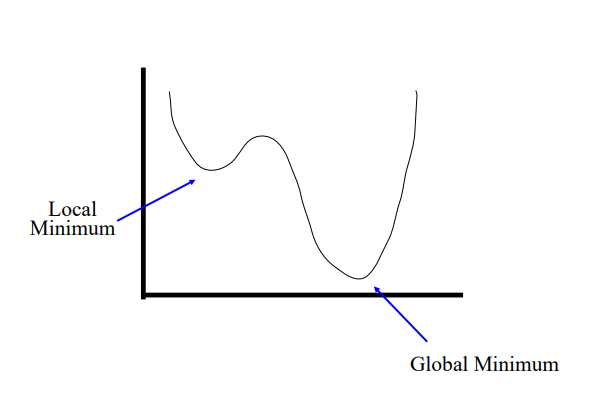

### Deterministic vs Stochastic

#### Deterministic Methods
- **Definition**: Deterministic methods are algorithms or processes that will always produce the same output from a given initial condition. There is no randomness involved in these methods, and they follow a specific set of rules.
- **Characteristics**:
  - The same input always leads to the same output.
  - The process is fully predictable and repeatable.
  - Often used in algorithms where the problem has a well-defined solution space (e.g., shortest path algorithms).
  - **Example**: Dijkstra's algorithm for shortest paths in graphs, which always finds the shortest path for a given input.

#### Stochastic Methods
- **Definition**: Stochastic methods introduce randomness or probability in their processes. The output can vary, even with the same initial input, due to random elements in the algorithm.
- **Characteristics**:
  - These methods are more exploratory, often used when the search space is too large or complex to explore exhaustively.
  - Different runs with the same input can lead to different outputs, potentially discovering better solutions in optimization problems.
  - **Example**: Simulated Annealing or Genetic Algorithms, which rely on randomness to explore the solution space more widely.

#### Key Differences
- **Predictability**: Deterministic methods always give the same result, while stochastic methods can give different results on different runs.
- **Exploration**: Stochastic methods explore a larger solution space due to randomization, while deterministic methods stick to a fixed path.
- **Efficiency**: Deterministic methods can be more efficient but may miss global optima, while stochastic methods can escape local minima but may require more computational effort.

---

### First-order Gradient Methods

- **Definition**: First-order gradient methods are optimization algorithms that use the first derivative (gradient) of the objective function to guide the search for the optimal solution.
- **How it works**: These methods follow the steepest descent direction to minimize (or maximize) a function by adjusting the variables in proportion to the negative of the gradient.
- **Characteristics**:
  - Only the gradient (first derivative) is needed, making them computationally inexpensive.
  - They work well for convex problems* but may get stuck in local minima in non-convex problems.
  - **Example**: *Gradient Descent*, *Stochastic Gradient Descent (SGD)*, *Momentum*, *Adam (ADAptive Moment)* Estimation

#### Advantages
- Simplicity and ease of implementation.
- Suitable for large-scale problems and real-time applications due to their efficiency.
- Can be enhanced with momentum or adaptive learning rates (e.g., *Adam Optimizer*).

#### Disadvantages
- May converge slowly.
- Can get stuck in local minima for non-convex problems.
- Requires careful tuning of the learning rate.

*A **convex problem** is an optimization problem where the objective function and the feasible region exhibit specific convexity properties. Convexity makes these problems easier to solve because local optima are also global optima.
e.g. Minimizing the quadratic function \( f(x) = x^2 \) is a convex problem because the function is convex, and it has a unique global minimum at \( x = 0 \).

### 1. Gradient Descent (GD)
### Definition:
Gradient Descent (GD) is an optimization algorithm that minimizes a cost function by computing the gradient (first derivative) of the cost function and updating the parameters in the opposite direction of the gradient.

#### Characteristics:
- **Full-batch Gradient**: It computes the gradient using the entire dataset.
- **Update Rule**:
  \[
  \theta_{t+1} = \theta_t - \alpha \nabla J(\theta)
  \]
  where \( \alpha \) is the learning rate, \( \theta_t \) is the parameter at time \( t \), and \( \nabla J(\theta) \) is the gradient of the cost function \( J(\theta) \).
  
#### Advantages:
- Guarantees a smooth and stable convergence in convex problems.
- Each step moves towards the optimal solution.

#### Disadvantages:
- **Computationally Expensive**: Requires computing the gradient on the entire dataset at every step, which can be slow for large datasets.
- **Memory-intensive**: Needs to load the entire dataset into memory.

---

### 2. Stochastic Gradient Descent (SGD)
#### Definition:
Stochastic Gradient Descent (SGD) is a variant of GD that updates the parameters using only one random sample (or a small batch) of the dataset at a time.

#### Characteristics:
- **Mini-batch or Single-sample Gradient**: It computes the gradient using a randomly selected data point or mini-batch at each iteration.
- **Update Rule**:
  \[
  \theta_{t+1} = \theta_t - \alpha \nabla J(\theta; \text{random sample})
  \]

#### Advantages:
- **Faster Updates**: Since each update only requires a single data point, it can perform updates much more quickly, especially for large datasets.
- **Better Generalization**: The noisy updates help prevent overfitting by introducing randomness.
- **Escapes Local Minima**: Due to the noisy updates, SGD can jump out of local minima in non-convex problems.

#### Disadvantages:
- **Noisy Convergence**: The randomness introduces noise, which can cause the parameter updates to overshoot the optimum or oscillate around it.
- **Requires Learning Rate Decay**: SGD often needs a decaying learning rate to stabilize the convergence.

---

### 3. Momentum
#### Definition:
Momentum is an extension of Gradient Descent that adds a velocity vector (or momentum term) to smooth out updates and speed up convergence, especially in directions with small gradients.

#### Characteristics:
- **Momentum-enhanced Gradient Descent**: It builds velocity from past gradients to make larger, more informed steps.
- **Update Rule**:
  \[
  v_{t+1} = \beta v_t + (1 - \beta) \nabla J(\theta_t)
  \]
  \[
  \theta_{t+1} = \theta_t - \alpha v_{t+1}
  \]
  where \( \beta \) (usually 0.9) is the momentum term and \( v \) is the velocity that builds up over time.

#### Advantages:
- **Faster Convergence**: Momentum accelerates movement along directions with consistent gradients, allowing for faster convergence.
- **Reduced Oscillations**: It helps reduce oscillations, especially in narrow or steep valleys in the optimization landscape.

#### Disadvantages:
- **Hyperparameter Tuning**: Momentum requires careful tuning of both the learning rate and the momentum parameter \( \beta \).

---

### 4. Adam (Adaptive Moment Estimation)
### Definition:
Adam is an adaptive learning rate optimization algorithm that combines the advantages of both SGD with Momentum and RMSProp (which adapts the learning rate for each parameter).

#### Characteristics:
- **Adaptive Learning Rates**: Adam adjusts the learning rate for each parameter using estimates of the first moment (mean of the gradients) and the second moment (variance of the gradients).
- **Update Rule**:
  1. **First Moment Estimate (Mean)**:
     \[
     m_t = \beta_1 m_{t-1} + (1 - \beta_1) g_t
     \]
  2. **Second Moment Estimate (Variance)**:
     \[
     v_t = \beta_2 v_{t-1} + (1 - \beta_2) g_t^2
     \]
  3. **Bias Correction**:
     \[
     \hat{m_t} = \frac{m_t}{1 - \beta_1^t}, \quad \hat{v_t} = \frac{v_t}{1 - \beta_2^t}
     \]
  4. **Parameter Update**:
     \[
     \theta_{t+1} = \theta_t - \alpha \frac{\hat{m_t}}{\sqrt{\hat{v_t}} + \epsilon}
     \]
     where \( \alpha \) is the learning rate, and \( \epsilon \) is a small constant to avoid division by zero.

#### Advantages:
- **Fast Convergence**: Adam converges quickly due to adaptive learning rates and momentum.
- **Less Hyperparameter Tuning**: The adaptive nature of Adam makes it easier to tune compared to vanilla GD or Momentum.
- **Handles Sparse Data**: Adam works well in scenarios with sparse data or noisy gradients.

#### Disadvantages:
- **Overfitting**: Adam’s fast convergence can sometimes lead to overfitting if the learning rate is not properly tuned.
- **Non-convergence in some cases**: Adam can fail to converge in certain settings compared to simpler methods like SGD.

---

### Summary Table

| Feature                           | Gradient Descent (GD)       | Stochastic Gradient Descent (SGD)  | Momentum                         | Adam                              |
|------------------------------------|-----------------------------|------------------------------------|-----------------------------------|-----------------------------------|
| **Gradient Computation**           | Full dataset                | Single sample or mini-batch        | Full dataset or mini-batch        | Adaptive (using first and second moments) |
| **Computational Cost per Update**  | High                        | Low                               | High                             | Moderate                          |
| **Update Frequency**              | Once per epoch              | Per sample/mini-batch             | Once per epoch                   | Once per sample/mini-batch        |
| **Learning Rate**                  | Constant                    | Constant or decaying              | Constant or decaying             | Adaptive                          |
| **Momentum**                       | No                          | No                                | Yes                              | Yes                              |
| **Speed**                          | Slow on large datasets      | Fast                              | Faster than GD                   | Fastest                           |
| **Convergence Stability**          | Stable but slow             | Noisy, oscillates                 | More stable than SGD             | Stable, fast, but can overfit     |
| **Best for**                       | Small datasets, convex problems | Large datasets, noisy problems    | Convex problems with faster convergence | Large datasets, non-convex problems |

---

### Second-order Newton’s Methods

- **Definition**: Newton's methods are second-order optimization techniques that use both the first and second derivatives (gradient and Hessian) to guide the search for the optimal solution.
- **How it works**: These methods utilize the Hessian matrix (second derivative of the function) to approximate the curvature of the solution space, allowing for faster and more accurate convergence towards the optimal solution.
- **Characteristics**:
  - Requires computation of the Hessian matrix, which makes it more computationally expensive compared to first-order methods.
  - Converges faster than first-order methods, especially near the optimal solution.
  - **Example**: *Newton's Method*, *Broyden–Fletcher–Goldfarb–Shanno (BFGS)* algorithm.

#### Advantages
- Faster convergence, especially near local or global minima.
- More accurate steps due to the use of second-order information.

#### Disadvantages
- High computational cost, especially for large problems, due to the need to compute the Hessian matrix.
- May be impractical for very large-scale problems.

---

### Single-solution Metaheuristics

- **Definition**: Single-solution metaheuristics focus on improving one candidate solution iteratively through local search techniques. These algorithms generally rely on making small modifications to the current solution and evaluating its performance.
- **Characteristics**:
  - These methods start with an initial solution and modify it iteratively to improve it.
  - They often incorporate strategies to escape local optima, such as simulated annealing.
  - **Example**: *Simulated Annealing*, *Tabu Search*.

#### Advantages
- Simple and easy to implement.
- Focuses computational power on improving one solution, potentially leading to fast convergence for small-scale problems.
- Suitable for problems where the neighborhood of a solution is easy to explore.

#### Disadvantages
- Can get stuck in local optima if the problem landscape is complex.
- Less diversity in exploration since only one solution is considered at a time.

---

### Population-based Algorithms

Covered in detail in [5.5 Population-based Algorithms](#sec-55-population-based-algorithms).

---

### Summary Table

| Feature                          | First-order Gradient Methods         | Second-order Newton's Methods        | Single-solution Metaheuristics       | Population-based Algorithms          |
|-----------------------------------|--------------------------------------|--------------------------------------|--------------------------------------|--------------------------------------|
| **Type**                          | First-order (uses gradient)          | Second-order (uses gradient + Hessian)| Iterative search using one solution  | Operates on a population of solutions|
| **Speed**                         | Fast but may be slow in non-convex   | Slower per step but faster convergence| Fast but may get stuck in local minima| Slower but explores larger search space|
| **Convergence**                   | Slower, may get stuck in local minima| Faster convergence near solution     | Moderate, risk of local minima       | Robust, avoids local minima          |
| **Computational Cost**            | Low (only first derivative)          | High (requires second derivative)    | Moderate                            | High (requires population evaluation)|
| **Example**                       | Gradient Descent, SGD                | Newton’s Method, BFGS                | Simulated Annealing, Tabu Search     | Genetic Algorithms, Particle Swarm   |

- Egg holder?

- 5.1 Asymptotic Complexity  
- 5.2 Classes of Problems  

P, NP, NP-complete

## 5.4 Classes of Problems

In optimization and computational complexity theory, problems are classified based on the time they take to be solved and the computational resources they require. The classification helps in understanding the difficulty of a problem and the best strategies to solve it.

### 1. Class **P**
- **Definition**: Problems in class **P** are those that can be solved in **polynomial time** on a deterministic computer.
- **Characteristics**:
  - Problems in class P are considered "tractable," meaning they can be solved efficiently.
  - The time required to solve the problem grows at a polynomial rate relative to the input size.
  - These problems have algorithms that run in time complexity such as \( O(n) \), \( O(n^2) \), or \( O(n^3) \), etc.
- **Examples**:
  - Quicksort
  - Binary search
  - Matrix multiplication

### 2. Class **NP**
- **Definition**: Class **NP** contains problems for which a proposed solution can be **verified** in polynomial time on a deterministic computer, but finding the solution may not necessarily be feasible in polynomial time.
- **Characteristics**:
  - NP problems are known as "intractable" problems because solving them efficiently is difficult.
  - If a solution is given, it can be checked quickly (in polynomial time).
  - **P** is a subset of **NP**: \( P \subseteq NP \), meaning that if a problem can be solved quickly (in class P), its solution can also be verified quickly (in class NP).
- **Examples**:
  - Subset sum problem
  - Sudoku
  - Traveling Salesman Problem (TSP)

### 3. Class **NP-Complete**
- **Definition**: NP-complete problems are a subset of NP problems that are among the hardest to solve. No polynomial-time algorithms are known for these problems, and it is unknown if any exist.
- **Characteristics**:
  - If a polynomial-time algorithm is found for any NP-complete problem, it can be used to solve all NP problems in polynomial time, implying \( P = NP \).
  - NP-complete problems require exponential time (or worse) to solve with known algorithms.
  - These problems are often solved using heuristics or approximation algorithms.
- **Examples**:
  - Traveling Salesman Problem (TSP), which has time complexity \( O(n^2 2^n) \)
  - Subset sum problem
  - Boolean satisfiability problem (SAT), which was the first problem proven to be NP-complete (Cook’s theorem, 1971)

### 4. **P vs NP Problem**
- **The Open Question**: "Is \( P = NP \)?" is one of the biggest unsolved questions in computer science.
- **Most Accepted Hypothesis**: It is widely believed that \( P \neq NP \), meaning that problems that can be verified quickly (NP) cannot always be solved quickly (P).

### 5. Approaches to NP Problems
Since NP-complete problems are difficult to solve efficiently, several approaches are typically used:
- **Approximation Algorithms**: Algorithms that find solutions that may not be optimal but are within a certain range of the optimal solution.
- **Heuristics and Metaheuristics**: Techniques that provide reasonably good solutions for many cases without guaranteeing optimality. These include methods like genetic algorithms and simulated annealing.
- **Simplification**: In some cases, simplifying the problem can make it easier to solve. For example, relaxing constraints or working with smaller problem instances.

- 5.3 Linear Programming  

[Linear Programming](https://en.wikipedia.org/wiki/Linear_programming)

A **feasible solution** is a set of values for the decision variables that satisfies all of the constraints in an optimization problem. The set of all feasible solutions defines the feasible region of the problem. Most optimization algorithms operate by first trying to locate any feasible solution, and then attempting to find another (better) feasible solution that improves the value of the objective function. This process of trying to find improving feasible solutions repeats until either no further improvement is possible or some other stopping criteria is met.

As shown in the illustration below, a global optimal solution is one where there is no other feasible solution with a better objective function value.  A local optimal solution is one where there is no other feasible solution "in the vicinity" with a better objective function value.

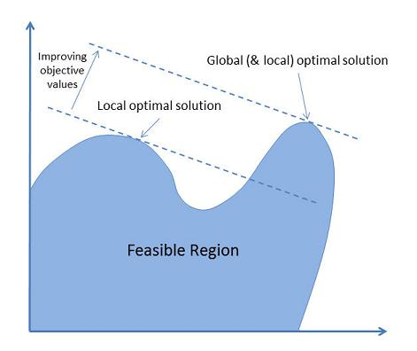

- 5.4 Search Space  

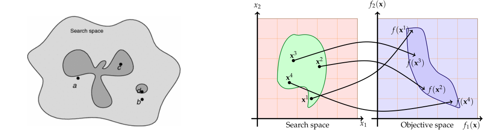

#### 1. Solution Space (S) and Objective Function (f)
- The **solution space (S)** represents all possible solutions to the optimization problem. Each point in this space is a potential solution.
- The **objective function (f)** evaluates each solution based on how well it satisfies the problem's goal (e.g., maximizing profit or minimizing cost). 

#### 2. Optimization Problem
- The goal is to solve the optimization problem \( O(S, f) \) by finding the **optimal solution** \( x_0 \in S \), such that:
  \[
  f(x) \leq f(x_0), \forall x \in S
  \]
  This means you are looking for the solution \( x_0 \) that minimizes or maximizes the objective function \( f(x) \) within the solution space \( S \).

#### 3. Constraints and Feasible Region
- **Constraints** are conditions that limit the solutions in the search space. They reduce the universe of solutions to a **feasible region** (denoted as \( X \subseteq U \)).

Constraints can either be:
Strong: These must be satisfied in any valid solution.
Weak: These are recommended to be satisfied but are not strictly mandatory.

- The feasible region is where all the constraints are satisfied, and only solutions inside this region are considered valid.

The choice between restricted and complete exploration depends on the problem and the computational resources available. In some cases, focusing on feasible solutions may save time but miss optimal solutions, while a complete search may offer more thorough exploration at the cost of increased computational effort.

- A **penalty function** is added to the original objective function to handle constraint violations. This allows the algorithm to explore infeasible regions but imposes penalties on solutions that violate the constraints.
  
#### Objective Function with Penalty:
\[
\text{Minimize } f'(x) = f(x) + w \cdot P(x)
\]
where:
- \( f(x) \): The original objective function.
- \( P(x) \): The penalty function, which penalizes violations of the constraints.
- \( w \): A weighting coefficient that determines the trade-off between minimizing the objective function and penalizing constraint violations.

- **When the solution \( x \) is feasible**, \( P(x) = 0 \), meaning there is no penalty applied.
- **When the solution \( x \) violates constraints**, \( P(x) \) increases based on the degree of violation. The more the violation, the larger the penalty, discouraging the algorithm from accepting infeasible solutions.

#### 4. Graphical Representation
- On the left side of the image:
  - The **search space** is shown as a large area with possible solutions scattered within it. The gray and shaded regions illustrate where solutions are feasible or infeasible.
- On the right side of the image:
  - The **search space** is mapped to the **objective space**.
  - The points \( x^1, x^2, x^3, x^4 \) in the search space correspond to values in the objective space, which are evaluated by the objective function \( f(x) \).
  - The arrows show how the solutions in the search space map to the objective values, where you are trying to find the point that optimizes \( f(x) \).

#### 5. Key Insights
- The **feasible region** reduces the set of all possible solutions to those that satisfy the problem’s constraints.
- The goal of the optimization is to search within the feasible region for the point that maximizes or minimizes the objective function \( f(x) \).
- The mapping from the search space to the objective space helps visualize how each solution performs according to the objective function.

https://en.wikipedia.org/wiki/Local_search_(optimization)

A local search algorithm starts from a candidate solution and then iteratively moves to a neighboring solution; a neighborhood being the set of all potential solutions that differ from the current solution by the minimal possible extent. This requires a neighborhood relation to be defined on the search space. As an example, the neighborhood of vertex cover is another vertex cover only differing by one node. For Boolean satisfiability, the neighbors of a Boolean assignment are those that have a single variable in an opposite state. The same problem may have multiple distinct neighborhoods defined on it; local optimization with neighborhoods that involve changing up to k components of the solution is often referred to as k-opt.

Typically, every candidate solution has more than one neighbor solution; the choice of which one to select is taken using only information about the solutions in the neighborhood of the current assignment, hence the name local search. When the choice of the neighbor solution is done by taking the one locally maximizing the criterion, i.e.: a greedy search, the metaheuristic takes the name hill climbing. When no improving neighbors are present, local search is stuck at a locally optimal point. This local-optima problem can be cured by using restarts (repeated local search with different initial conditions), randomization, or more complex schemes based on iterations, like iterated local search, on memory, like reactive search optimization, on memory-less stochastic modifications, like simulated annealing.

Local search does not provide a guarantee that any given solution is optimal. The search can terminate after a given time bound or when the best solution found thus far has not improved in a given number of steps. Local search is an anytime algorithm; it can return a valid solution even if it's interrupted at any time after finding the first valid solution. Local search is typically an approximation or incomplete algorithm because the search may stop even if the current best solution found is not optimal. This can happen even if termination happens because the current best solution could not be improved, as the optimal solution can lie far from the neighborhood of the solutions crossed by the algorithm.

### 5.5 Memoryless vs Memory-based

Metaheuristics are optimization algorithms used to solve complex problems where traditional methods may be inefficient. They are generally categorized into two types: **memoryless** and **memory-based** metaheuristics.

#### 1. **Memoryless Metaheuristics**
- **Definition**: Memoryless metaheuristics do not retain information about past solutions or the search history. Each decision made during the search process is based solely on the current solution or state, with no influence from previous iterations.
  (Most memoryless metaheuristics can be modified to become memory-based)

##### Characteristics:
- **No Memory**: The algorithm only uses the current solution and its immediate neighbors to decide the next move. It does not store or leverage past solutions.
- **Focus on Exploration**: These metaheuristics often rely on randomization or stochastic processes to explore the search space.
- **Suitable for Large Problems**: Since no memory is stored, these methods can be computationally efficient in problems where storing or accessing past information is impractical.
  
##### Examples:
- **Simulated Annealing**: It uses random sampling to explore new solutions without retaining memory of past solutions.
- **Randomized Local Search**: It evaluates the neighbors of the current solution without considering previous states.

### 2. **Memory-Based Metaheuristics**
- **Definition**: Memory-based metaheuristics retain and use information from previous solutions to guide the search process. These algorithms leverage the search history to avoid revisiting poor solutions and to focus on promising areas of the search space.
  
#### Characteristics:
- **Use of Memory**: These algorithms store past information, such as the best solutions, the frequency of solution features, or areas to avoid (e.g., Tabu List).
- **Guided Search**: By remembering previous moves and results, the algorithm can make more informed decisions and adapt the search strategy.
- **Balancing Exploration and Exploitation**: The use of memory helps in balancing between exploring new areas of the solution space and exploiting known good areas.
  
#### Examples:
- **Tabu Search**: Uses a memory structure called a "tabu list" to store recently visited solutions and avoid cycling back to them.
- **Genetic Algorithms**: Store and evolve a population of solutions over iterations by keeping track of "genetic material" (solutions) and using operators like crossover and mutation.
  
- **Memoryless metaheuristics** are simpler, faster, and require less computational overhead, making them suitable for problems where memory is limited or where fast exploration is needed.
- **Memory-based metaheuristics** use memory to avoid revisiting poor solutions, resulting in a more informed and potentially more effective search, though at the cost of increased complexity and memory usage.

[Simulated annealing](https://en.wikipedia.org/wiki/Simulated_annealing
) is a probabilistic optimisation algorithm inspired by the annealing process in material science. 
It is used to find a near-optimal solution among an extremely large (but finite) set of potential solutions. It is particularly useful for combinatorial optimization problems defined by complex objective functions that rely on external data.

The process involves:

1. Randomly move or alter the state
2. Assess the energy of the new state using an objective function
3. Compare the energy to the previous state and decide whether to accept the new solution or reject it based on the current temperature.
4. Repeat until you have converged on an acceptable answer
5. For a move to be accepted, it must meet one of two requirements:

The move causes a decrease in state energy (i.e. an improvement in the objective function)
The move increases the state energy (i.e. a slightly worse solution) but is within the bounds of the temperature. The temperature exponetially decreases as the algorithm progresses. In this way, we avoid getting trapped by local minima early in the process but start to hone in on a viable solution by the end.

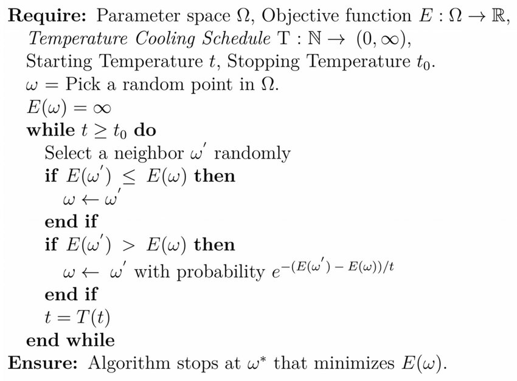

The cooling temperature \(T(t)\) (aka Temperature Descent) defines how the temperature decreases over time
As the temperature 𝑡 decreases, the probability of accepting worse solutions (as defined by the probability function \(𝑒^{−(E(ω ′ )−E(ω))/t }\)) reduces, making the algorithm focus more on local improvements and less on random exploration.

--

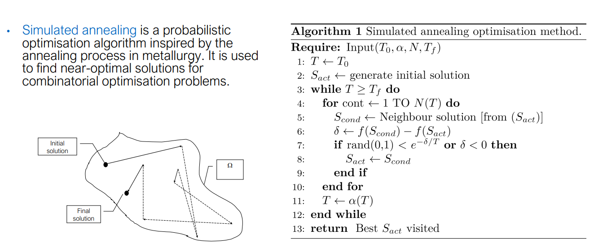
--

#### Game Balancing Example Using Simulated Annealing

Let's consider a scenario where **Simulated Annealing (SA)** is used to balance a **role-playing game (RPG)** where different **character classes** (e.g., warrior, mage, archer) need to be balanced in terms of their **damage output**, **defense**, and **abilities**. The goal is to ensure no class is overpowered or too weak, providing a fair and enjoyable gameplay experience.

##### Scenario:
In a multiplayer RPG, players can choose different classes (e.g., warrior, mage, archer). Each class has the following attributes:
- **Health Points (HP)**: Durability or survivability of the class.
- **Attack Damage (AD)**: Damage the class deals per attack.
- **Defense (DEF)**: Reduces the incoming damage.
- **Special Abilities**: Each class has unique abilities that affect gameplay.

The current state of the game is imbalanced:
- The **mage** deals too much damage, making it overpowered.
- The **warrior** has too much health and defense, making it hard to defeat.

Our goal is to balance the classes by adjusting their stats and abilities.

##### Problem Definition:
The problem is framed as an **optimization problem** where we aim to adjust the stat values (HP, AD, DEF) and abilities to minimize an **imbalance score** — a measure of how unbalanced the game is.

- **Objective**: Minimize the imbalance score across all classes.
- **Constraints**: Each class must retain its distinct playstyle (e.g., the mage focuses on damage but can't be overpowered).

#### Steps Using Simulated Annealing:

##### 1. Define the Solution Space:
Each possible **combination of stat values** (HP, AD, DEF) and **ability strength** for the classes represents a point in the solution space. For example:
- **Warrior**: HP = 3000, AD = 100, DEF = 200.
- **Mage**: HP = 1500, AD = 300, DEF = 50.
- **Archer**: HP = 2000, AD = 200, DEF = 100.

##### 2. Define the Objective Function (Imbalance Score):
The **imbalance score** \( f(x) \) measures how unbalanced the game is. The goal is to minimize this score, which can be based on:
- **Win/loss ratios** between classes.
- **Damage per second (DPS)** and survivability.

A simple imbalance score can be:
\[
f(x) = | \text{DPS}_{\text{warrior}} - \text{DPS}_{\text{mage}} | + | \text{DPS}_{\text{warrior}} - \text{DPS}_{\text{archer}} | + \ldots
\]
Where \( \text{DPS}_{\text{class}} \) represents the damage per second for each class.

##### 3. Generate an Initial Solution:
Start with an initial configuration of stats, which could be the current unbalanced state:
- **Warrior**: HP = 3500, AD = 100, DEF = 250.
- **Mage**: HP = 1200, AD = 350, DEF = 50.
- **Archer**: HP = 2200, AD = 220, DEF = 150.

##### 4. Iteratively Explore Neighboring Solutions:
- **Transformations**: Adjust the stats of one or more classes slightly (e.g., reduce the mage’s AD, increase the warrior’s AD, adjust the HP of the archer).
- **Evaluate the new imbalance score** for the adjusted configuration. Accept the new solution if the score improves, or accept it with some probability if the score worsens to allow exploration.

##### 5. Simulate Battles (Evaluate Objective Function):
Simulate battles between the classes (e.g., warrior vs. mage, mage vs. archer) and record the win/loss ratios, DPS, and survivability. Use these results to compute the new imbalance score.

##### 6. Cooling Schedule (Temperature Descent):
Use a cooling schedule to gradually reduce the temperature, transitioning from exploration to exploitation. A common cooling schedule:
\[
t = t_0 \times \alpha^k
\]
Where \( \alpha \) is a cooling factor (e.g., 0.95) and \( k \) is the current iteration.

##### 7. Convergence:
The algorithm continues to adjust the stats until it converges to a balanced configuration where the imbalance score is minimized. A final balanced solution might look like:
- **Warrior**: HP = 3000, AD = 110, DEF = 200.
- **Mage**: HP = 1500, AD = 290, DEF = 60.
- **Archer**: HP = 2000, AD = 200, DEF = 120.

This configuration ensures that no class is too weak or too strong while maintaining their unique playstyles.

##### Summary of Balanced Solution:
After running Simulated Annealing, the algorithm finds a balanced set of stats and abilities for the classes:
- **Warrior**: High defense and moderate attack, designed to be a tank.
- **Mage**: High damage with low defense, focusing on powerful spells.
- **Archer**: Balanced between attack and defense, specializing in ranged attacks.

#### Tabu Search

https://en.wikipedia.org/wiki/Tabu_search

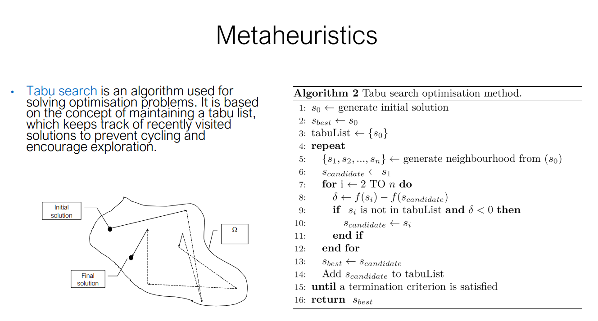

At each step, the algorithm evaluates a set of neighboring solutions to decide the next move. These neighboring solutions are generated by making small changes (called moves) to the current solution.
Before a move is accepted, the algorithm checks the Tabu List to ensure the move isn't "tabu" (forbidden). If the move is in the Tabu List, it is typically not considered, unless an aspiration criterion is met (e.g., the move produces a new global best solution).
Once a move is made and a new solution is reached, the move or solution is added to the Tabu List for a fixed number of iterations (the Tabu Tenure), preventing the algorithm from reversing the move or re-exploring that solution in the near future.

#### Main Characteristics:
- **Memory-based**: The **Tabu List** prevents cycling and revisiting the same solution.
- **Flexible exploration**: The algorithm can explore worse solutions to escape local minima.
- **Aspiration criteria**: Allows overriding the tabu status if the move leads to a solution that is significantly better than any found before.

#### Tabu Search Algorithm (Pseudocode)

1. **Initialization**:
   - \( s_0 \leftarrow \text{generate initial solution} \): Generate an initial solution \( s_0 \).
   - \( s_{\text{best}} \leftarrow s_0 \): Set the best solution \( s_{\text{best}} \) to the initial solution.
   - **Tabu List** \( \leftarrow \{ s_0 \} \): Initialize the Tabu List with the starting solution \( s_0 \).

2. **Main Loop**:
   - **Repeat until a termination criterion is met**:
     - **Neighborhood Generation**: Generate a set of neighboring solutions \( \{ s_1, s_2, \dots, s_n \} \) from the current solution \( s_0 \).
     - **Select a Candidate**: 
       - Set the candidate solution \( s_{\text{candidate}} \leftarrow s_1 \).
       - **Evaluate each neighbor** \( s_i \):
         - Compute the change in the objective function: \( \delta \leftarrow f(s_i) - f(s_{\text{candidate}}) \).
         - If the neighbor \( s_i \) is not in the Tabu List and \( \delta < 0 \) (i.e., it's a better solution), update \( s_{\text{candidate}} \leftarrow s_i \).
     - **Update Current Best**:
       - If \( s_{\text{candidate}} \) is better than \( s_{\text{best}} \), update \( s_{\text{best}} \leftarrow s_{\text{candidate}} \).
     - **Update Tabu List**:
       - Add the new \( s_{\text{candidate}} \) to the Tabu List to prevent immediate revisiting.
       - Remove old entries from the Tabu List when they exceed a certain length (Tabu Tenure).
   
3. **End Condition**: The algorithm repeats the process until a stopping criterion is met (e.g., a fixed number of iterations, or no improvement in a set number of iterations).

4. **Return**: The best solution \( s_{\text{best}} \) found during the search.

#### Example Steps:
- **Initial Solution**: Begin with an initial solution (e.g., a specific configuration in a combinatorial problem).
- **Neighborhood Exploration**: Generate nearby solutions by making small changes (e.g., swapping elements).
- **Tabu List**: If a move has already been explored recently, mark it as "tabu" to prevent cycling.
- **Aspiration Criteria**: Even if a solution is on the Tabu List, allow it if it represents a significant improvement over the current best solution.

#### Summary:
**Tabu Search** enhances local search by:
- Using memory to avoid cycling through previously visited solutions.
- Exploring new areas of the search space by accepting worse solutions temporarily.
- Providing a mechanism (Tabu List) to remember recent moves and guide the search process effectively.

--

## 5.5 Population-based Algorithms

Population-based algorithms operate on a population of candidate solutions rather than a single solution.
 The population is typically initialized randomly or using heuristic techniques. Multiple solutions are evaluated simultaneously, allowing for the exploration of the search space more efficiently.

• Advantages: ability to simultaneously explore multiple regions of the search space, promoting diversity and preventing premature convergence to suboptimal solutions.
• Disadvantages: it may require careful parameter tuning and can be computationally demanding due to the population size and iterative nature of the algorithms.
• Examples of bio-inspired population-based methods include ant colony optimisation, black hole algorithm, particle swarm optimisation, and genetic algorithms.

#####  Genetic Algorithms

[Genetic Algorithm](https://en.wikipedia.org/wiki/Genetic_algorithm) is a metaheuristic based on Darwin’s evolution theory
 
which models the process of evolution in nature by applying evolutionary operators (like mutation, crossover, and selection) to a population of candidate solutions, which are analogous to chromosomes.
The goal of GA is to optimize a given objective (fitness) function by iteratively evolving a population of solutions.

https://www.youtube.com/watch?v=XP2sFzp2Rig&t=23s

• “One general law, leading to the advancement of all organic beings, namely,
multiply, vary, let the strongest live and the weakest die.” Charles Darwin.
• Stochastic search technique based on the mechanisms of natural selection and
natural genetics.
• Use analogies of natural selection to develop better solutions.
• Widely used in problems of nonlinear and high-dimensional optimisation.

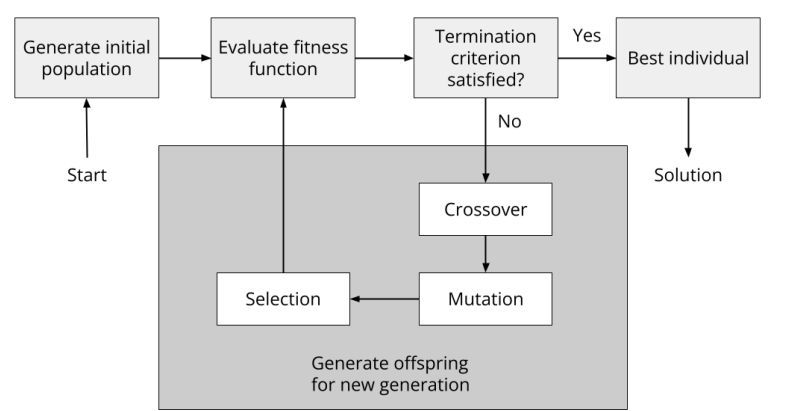

The diagram illustrates the 5 steps in a genetic algorithm:

1. Generate Initial Population: Start by randomly generating an initial population of candidate solutions.
2. Evaluate Fitness Function: Each candidate solution is evaluated based on a fitness function that measures its quality or how well it solves the problem.
3. Check Termination Criteria: If the termination criteria (e.g., a set number of iterations or reaching an optimal solution) are met, the algorithm ends, and the best individual is returned as the solution.
4. Crossover and Mutation: If the termination criteria are not satisfied, the algorithm proceeds to apply crossover and mutation to create new offspring, which will form the population for the next generation.
5. Selection: The best-performing individuals are selected for reproduction in the next generation, promoting the survival of the fittest.

##### Terminology 

The **chromosome** represents a possible solution to the problem, composed of genes (bits) with specific **alleles** at particular loci.
The **genotype** is the internal structure (how the solution is represented), while the **phenotype** is the external interpretation or output of the solution.

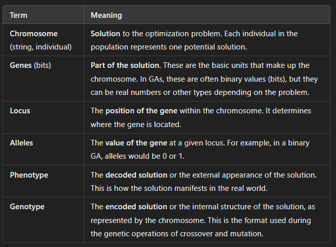

The search space is explored by applying transformations to candidate solutions,
just as observed in living organisms: crossover, mutation, and selection.

GA has 3 core operators: Crossover, Mutation, and Selection:
- Selection: Select individuals based on their fitness scores. Fitter individuals are more likely to be selected for reproduction.
- Crossover: Combine parts of two parent solutions to create offspring (new solutions).
- Mutation: Introduce small random changes to individuals to maintain diversity.

**Selectvie Pressure** describes how strongly the algorithm favors better-performing solutions over weaker ones during the selection process.
• High pressure: Can speed up the algorithm by quickly focusing on the best solutions but the search may end prematurely (intensification, premature convergence where diversity is lost, and the algorithm might get stuck in local optima.)
• Low pressure: Increases diversity in the population and reduces the risk of premature convergence but progress is slower than necessary.
• The ideal approach is to maintain low pressure at the beginning for broad
exploration, and high pressure towards the end to exploit more promising areas.

Chromosome commonly represented as strings of bits or binary representation.
• Parameters include population size and probability of applying the genetic operators

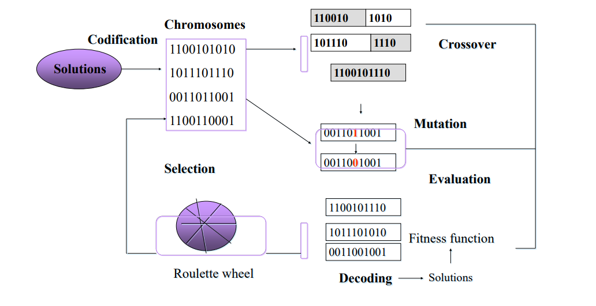

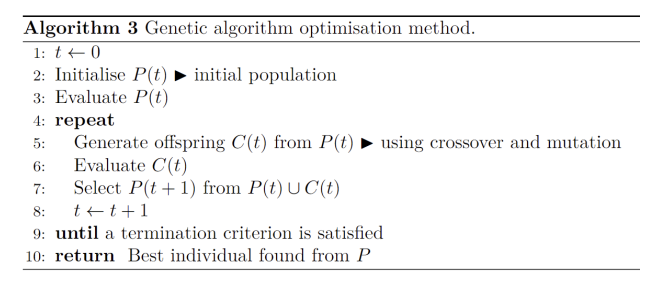

This pseudocode describes the steps followed by a **Genetic Algorithm (GA)** to evolve solutions over generations, ultimately aiming to optimize a given problem.

1. **t ← 0**  
   Initialize the generation counter `t` to 0.

2. **Initialize P(t)**  
   Generate an initial population \( P(t) \), a collection of randomly generated candidate solutions.

3. **Evaluate P(t)**  
   Calculate the fitness of each individual in the population \( P(t) \). The fitness function determines how good each solution is in solving the problem.

4. **repeat**  
   The algorithm repeatedly performs the following steps until a termination criterion is met (such as a maximum number of generations or when the solution converges):

   5. **Generate offspring C(t)**  
      Create a new set of candidate solutions (offspring) \( C(t) \) from the current population \( P(t) \) by applying genetic operators:
      - **Crossover**: Combine pairs of parent solutions to produce offspring.
      - **Mutation**: Introduce random changes to offspring to maintain diversity.

   6. **Evaluate C(t)**  
      Calculate the fitness of each individual in the new offspring population \( C(t) \).

   7. **Select P(t + 1)**  
      Create the next generation population \( P(t+1) \) by selecting individuals from both the current population \( P(t) \) and the new offspring \( C(t) \). This selection favors fitter individuals to ensure that the next generation is more likely to contain better solutions.

   8. **t ← t + 1**  
      Increment the generation counter.

9. **until a termination criterion is satisfied**  
   The loop continues until a termination criterion is met, such as:
   - A maximum number of generations has been reached.
   - The population has converged to a stable solution (no further significant improvement in fitness).

10. **Return the best individual found from P**  
    Once the algorithm terminates, return the best solution from the final population \( P \).

---

##### Summary of Key Steps:
- **Initialization**: Start with a random population.
- **Evaluation**: Calculate the fitness of each solution.
- **Genetic Operators**: Apply crossover and mutation to create new offspring.
- **Selection**: Form the next generation by selecting the best individuals.
- **Termination**: The process continues until a termination condition is met, and the best solution is returned.

#### Uniform vs Expanded Generation Size:
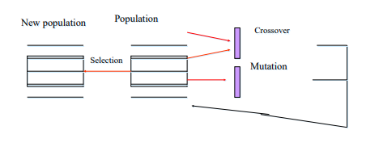

In this approach, the size of the new generation is the same as the previous generation. This ensures that the algorithm maintains a constant population size across iterations.
The diagram shows the flow:
- Population (current generation) undergoes crossover and mutation to produce offspring.
- A selection mechanism picks individuals from both the current population and the offspring to form the new population.

This ensures the new generation maintains a uniform size and consists of a combination of both newly generated offspring and some retained parents.

In the traditional version of genetic algorithms, all offspring replace all parents in the next generation.
However, the approach shown in the diagram allows a mix of all offspring and some parents to form the new population. This helps maintain some level of diversity and allows potentially strong parent solutions to persist into the next generation, preventing premature convergence to suboptimal solutions.

**Expanded generation size** means that the size of the new generation is increased compared to the previous generation.
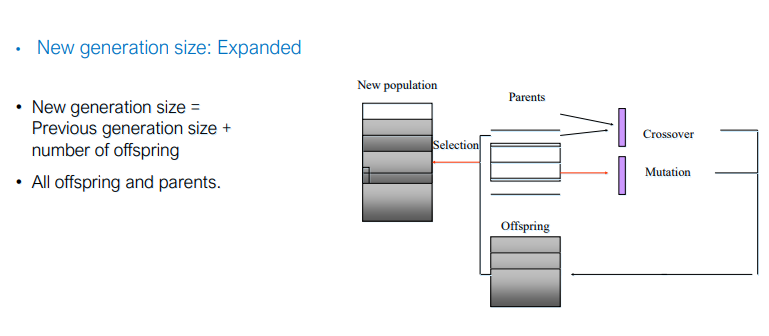
- The new generation size is calculated as: New generation size = Previous generation size + Number of offspring
- This means the new population contains **all parents** and **all offspring** produced through genetic operations like crossover and mutation.

- **All offspring and parents** are included in the next generation. This method keeps both the existing parents (which may contain well-performing solutions) and all newly generated offspring. By expanding the population, the algorithm increases the diversity of the candidate solutions in each iteration.

- **Parents**: The existing population (current generation).
- **Offspring**: New solutions generated from parents using **crossover** and **mutation** operations.
- **Selection**: A process to choose the new population from both **parents** and **offspring**. This ensures a mixture of both old (parents) and new (offspring) solutions.

The new population includes both parents and offspring, resulting in an expanded population size. This approach keeps both parents and offspring, which increases the population size over generations. 

It helps maintain diversity by keeping previous solutions while also allowing new solutions to enter the population. However, this approach requires managing a larger population size, which can increase computational complexity.

#### Stochastic Sampling vs Deterministic Sampling in Genetic Algorithms

In genetic algorithms (GA), selection is a crucial process that determines which individuals from the current population are chosen to pass their genes (solutions) to the next generation. Two broad categories of selection methods are stochastic sampling and deterministic sampling. These methods influence how the algorithm balances exploration and exploitation during the evolutionary process.

Stochastic sampling: prevent super chromosomes. For instance, roulette wheel.

Deterministic sampling: sort chromosomes according to their fitness and choose
the best ones. Elitist selection
